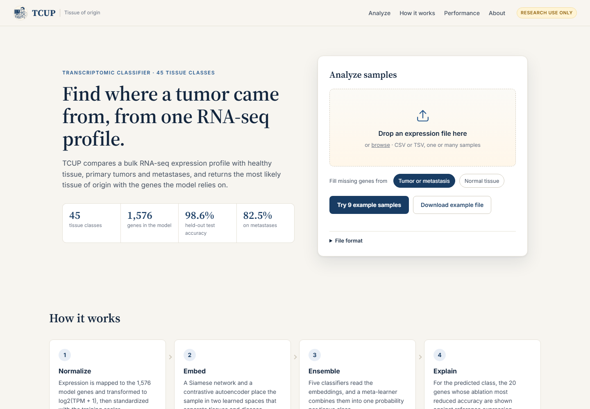
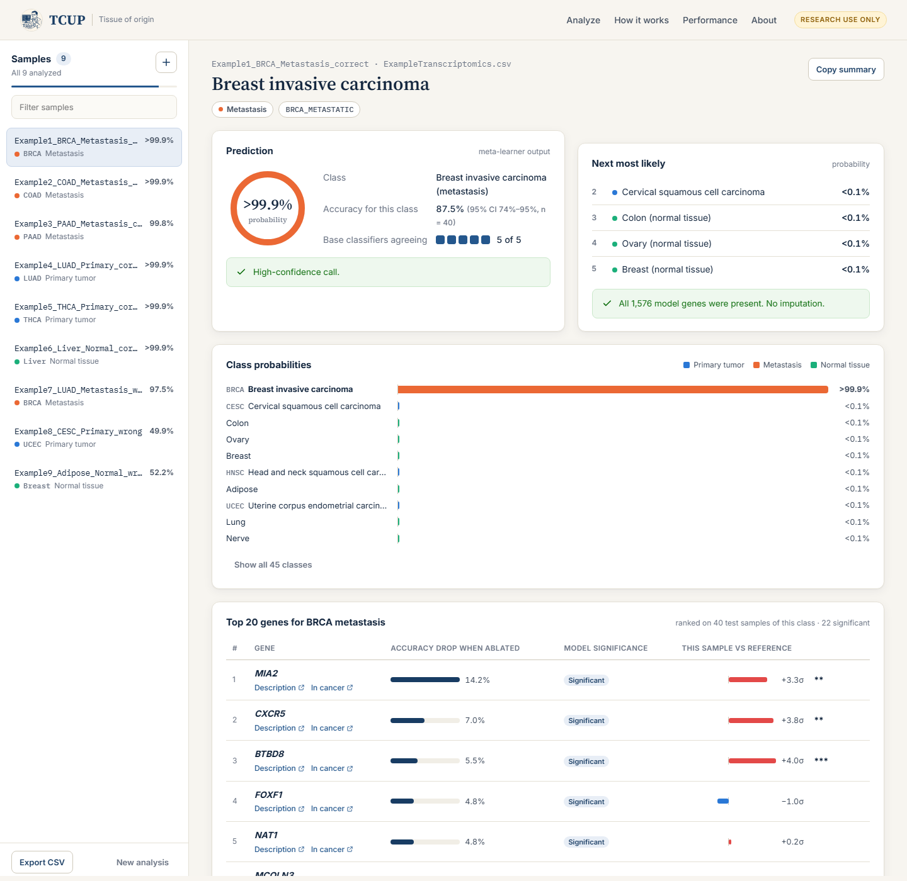

# TCUP – Tissue‑of‑Origin Prediction for Cancer of Unknown Primary (CUP)

**TCUP** is an open‑access web‑application and model suite that predicts the most likely tissue of origin for:

* cancers of unknown primary (CUP)  
* any transcriptomic sample (e.g. TCGA, GTEx, metastatic, healthy)

The method couples a **Contrastive Auto‑Encoder (CAE)** for representation learning with a **Siamese Neural Network (SNN)** meta‑learner trained on curated TCGA, GTEx and metastatic cohorts. The embedding generated by both models are then fed to 5 base classifiers which are fine-tuned to elicit the best prediction through a Meta Learner (MLP).   For full methodology see the pre‑print:

> Landau O., Rubin E. “TCUP - An Open Access Tool to Predict Tissue of Origin for Cancer of Unknown Primary (CUP)” (in preparation, 2025).

---

# Update-  **TCUP v2 update notes**

**Data & Normalization:**

- All three sources are now in the same unit: TPM computed with one formula and the same gene lengths from raw counts (GTEx gene reads, TCGA RSEM counts, metastatic RSEM expected counts), then log2(TPM+1)
- Only discordant metastases are kept (samples whose biopsy site equals the primary site are removed); metastatic classes with fewer than 5 samples are removed
- KNN imputation is fitted on training samples only, and every sample is brought back to a total of 1,000,000 TPM after imputation

**Splits & Leakage:**

- GTEx and TCGA are split 60:20:20, stratified by label and grouped by donor (GTEx) or patient (TCGA), so no donor or patient appears in two splits
- The metastatic held-out test set is unchanged in size (20 LUAD, 25 PAAD, 40 BRCA, 35 COAD); the remaining metastatic samples are split 75:25 into train and validation
- Leakage checks on sample ID, donor/patient ID and identical expression profiles, before and after scaling and SMOTE

**Gene Selection:**

- New gene list of 1,576 genes: one-vs-rest LASSO on real training samples only (no validation, test or synthetic samples), using the strictest penalty that keeps at least 1,500 genes
- StandardScaler fitted on training samples; SMOTE applied per metastatic class on training samples only

**Models:**

- SNN and CAE architectures, losses and epochs are unchanged. Positive metastatic pairs now require the same tissue label, and negative partners are drawn at random
- Base classifiers are tuned once with GridSearchCV on base-training data, and the out-of-fold meta-features use the tuned settings
- Base classifiers are trained on the training split plus 70% of the validation split; the meta-learner architecture is chosen on the remaining 30% of validation, which the embedders and base classifiers never saw. The test set is scored once, with the chosen model
- Results are reported over the 45 classes that have test samples. HNSC, SKCM, STAD and UCEC metastases have training samples only and are not given as predictions

**Model Interpretation:**

- Monte Carlo gene ablation (noise σ = 20, 10 cycles) on the held-out test set. A gene is significant when its accuracy drop stands out against all other genes (robust z-score), after Benjamini-Hochberg correction (FDR < 0.05)

**Web Application:**

- New interface: several samples per upload, a probability bar plot, and the 20 most influential genes for the predicted class with GeneCards and PubMed links
- `ExampleTranscriptomics.csv` now holds 9 held-out test samples in TPM: 6 the model gets right and one wrong from each source (GTEx, TCGA, metastatic)

**Performance (5 seeds, held-out test set):**

- Overall 98.56 ± 0.13%, GTEx 99.28 ± 0.10%, TCGA 98.76 ± 0.22%, metastatic 77.67 ± 3.82%
- Deployed model (seed 42): overall 98.57%, metastatic 82.50%

Full v2 script and the standalone Monte Carlo script can be found in the Script directory. The deployed model is the seed-42 v2 model.

# Update-  **TCUP v1.5 update notes**

**Meta-Learning Pipeline Improvements**:

- Implemented nested 64-16-20 split strategy (merged original 60% train + 20% val → 80% development set, then re-split into 80-20 splits for base classifiers(64% base-train and 16% meta-validation).
- Added GridSearchCV hyperparameter tuning for all base classifiers (4 hyperparameters per classifier, 5-fold cross-validation)
- Implemented cross-validation-based meta-feature generation (5-fold CV on 64% base-train produces out-of-fold predictions)
- Final meta-learner retrained on 64% base-train (using CV-generated meta-features) with 16% meta-validation monitoring before final test evaluation

**Data Quality & Reproducibility:**

- Added comprehensive duplicate removal (genes and samples) across all datasets before preprocessing
- Implemented donor-aware splitting for GTEx data to prevent sample leakage from same donors across train/val/test splits
- Enhanced data integrity unit tests covering SAMPLE_ID leakage, DONOR_ID leakage, duplicate detection, NaN/Inf checks, and label encoder consistency
- Added deterministic operations with fixed random seed (SEED=42) across all libraries including TensorFlow GPU operations
- Moved SMOTE application to after feature selection and standardization to prevent synthetic-from-synthetic data generation and ensure SMOTE operates on final feature space
- Added adaptive k_neighbors for SMOTE based on class sizes to handle small metastatic classes (min 1, max 5 neighbors)
  
**Documentation & Transparency:**

- Added detailed logging and checkpointing system for all preprocessing and training stages
- Generated comprehensive CSV reports tracking label counts, SMOTE operations, and split distributions
- Improved error handling with informative messages and automatic checkpoint recovery

**Performance:**

- Results: Similar to original with mild improvements in accuracy metrics
- All improvements validated on held-out 20% test set

## 🌳 Repository layout

```text
.
├── app.py                                 # Web app entry-point (gunicorn app:server)
├── server.py                              # Web server and API
├── engine.py                              # Prediction pipeline used by the web app
├── ExampleTranscriptomics.csv             # 9 example samples (TPM)
│
├── Median_Gene_Values_Cancer.pkl          # Gene-wise medians – cancer
├── Median_Gene_Values_Healthy.pkl         # Gene-wise medians – healthy
├── Std_Gene_Values_Cancer.pkl             # Gene-wise σ – cancer
├── Std_Gene_Values_Healthy.pkl            # Gene-wise σ – healthy
│
├── BalancedMetastaticStandardScaler.pkl   # StandardScaler (log₂ TPM data)
├── label_encoder.pkl                      # Tissue label encoder
│
├── best_meta_learner_3.h5                 # Final MLP meta-learner
├── snn_model.h5                           # Siamese Neural Network backbone
├── cae_autoencoder_dual_loss.h5           # Contrastive Auto-Encoder (full)
├── cae_encoder.h5                         # Encoder only (inference-time)
├── cae_decoder.h5                         # Decoder only
├── nets_numpy.npz                         # SNN, CAE encoder and meta-learner weights for the web app
│
├── feature_sets.pkl                       # Lasso-selected gene list
├── trained_base_classifiers.pkl           # Five base classifiers (RF, XGB …)
├── monte_carlo_gene_importance_averaged.csv  # 10× MC gene-ablation scores
├── test_split_metrics.csv                 # Held-out test metrics
│
├── requirements.txt                       # Python dependencies
│
├── assets/                                # Web page, CSS, script, logo
│   └── …  index.html, style.css, script.js, logo.png
├── images/                                # Screenshots for the README
│   ├── LandingPage.png
│   └── ResultsPage.png
├── Script/                                # End-to-end training pipeline
│   ├── TCUP v2.py
│   ├── Stand-alone MonteCarlo.py
│   └── requirements.txt
├── Data                          # End-to-end training pipeline
│   └── URL to a Drive link with all the data
└── README.md                              # <–– you are here


```

### Key artefacts

| Path                                                      | Purpose                                                                                                 |
| --------------------------------------------------------- | ------------------------------------------------------------------------------------------------------- |
| **app.py**                                                | Launches the web UI & prediction pipeline                                                               |
| **Median\_Gene\_Values\_Cancer.pkl** / **…\_Healthy.pkl** | Per-gene medians used to impute missing genes                                                           |
| **Std\_Gene\_Values\_Cancer.pkl** / **…\_Healthy.pkl**    | Per-gene standard deviations for z-score significance tests                                             |
| **BalancedMetastaticStandardScaler.pkl**                  | Scaler applied to log₂-transformed TPM expression before inference                                      |
| **label\_encoder.pkl**                                    | Maps integer IDs ⇄ tissue labels for probability vectors                                                |
| **snn\_model.h5**                                         | Siamese Neural Network generating sample embeddings                                                     |
| **cae\_autoencoder\_dual\_loss.h5**                       | Contrastive Auto-Encoder (joint loss) – produces latent representation fed to base classifiers          |
| **trained\_base\_classifiers.pkl**                        | Five fine-tuned base models (RF, XGB, LR, k-NN, SVM) that vote via the meta learner                     |
| **best\_meta\_learner\_3.h5**                             | Multi-layer perceptron combining base classifier logits into final probabilities                        |
| **nets\_numpy.npz**                                       | The same SNN, CAE encoder and meta-learner weights, so the web app runs without TensorFlow              |
| **monte\_carlo\_gene\_importance\_averaged.csv**          | Averaged single-gene ablation impact (10-run Monte-Carlo) with FDR – drives the “20 most influential genes” list |
| **test\_split\_metrics.csv**                              | Held-out test-set metrics, used to display *TCUP accuracy* for each tissue                              |
| **ExampleTranscriptomics.csv**                            | Example showing the required file format for uploads                                                    |


---

## 🚀 Quick start

```bash
# 1. clone repo
git clone https://github.com/OhadLandau/TCUP.git
cd TCUP

# 2. install deps
python -m venv venv && source venv/bin/activate  # optional
pip install -r requirements.txt

# 3. launch the web server
python app.py
```

The app starts on **http://127.0.0.1:8050** by default when cloned, otherwise the app if deployed on Render with the following URL- https://tcup.onrender.com/

---

## 🖼  UI tour

| Landing | Results |
|---------|---------|
|  |  |

* **Landing page** – drag‑and‑drop a CSV/TSV of **TPM** values where the **first column is `sample_id`** and the rest are *HGNC gene symbols* (genes as rows also work). Several samples can be uploaded at once. Choose **Cancer** vs **Healthy** to select the assumed tissue type, this will add missing genes and compute the Over/Under expression of most significant genes in predicting the predicted label in your sample (from models intepertation stage - see paper) against the closest assumed reference data.  
* **Results page** – shows:  
  1. 45 class probabilities (barplot), top to bottom.  
  2. Predicted tissue + model‑confidence (bold) - Probabilities and Models accuracy for that label on the test set.  
  3. **TCUP accuracy** – historical accuracy for that tissue on an unseen test set (≈ accuracy for the given label).  
  4. The 20 most influential genes in the decision (σ from the reference median; significant genes marked), with GeneCards and PubMed links.

---

## 📈 Interpreting the output

* **Predicted tissue** – the label (e.g. `SKCM_TCGA`) with the highest posterior probability.  
* **Probability** – the softmax score from the meta learner (0‑1).  
* **TCUP accuracy** – *held‑out* test‑set accuracy **for that tissue** only.  
  *Example*: “TCUP accuracy ≈ 96.7 %” means that, across the unseen test set melanoma (SKCM) samples were 96.7 %  correctly classified by TCUP.

If your sample’s probability is low (<0.4) or multiple tissues cluster tightly, treat the prediction with caution and consider further histopathological or molecular work‑up. We would advise to utilize the tool merely as 'advice', this is not clinicaly verified and should not be applited in clinical practifce.  

---

## 🛠  Retraining

1. Raw expression matrices (TCGA, GTEx, metastatic) were not uploaded due to the significant size of the files, to use the data for potential retraining contact us - olandau4@gmail.com - and we will find a solution to transfer the data. 
2. Once data obtained, place the files in one folder (or set the `TCUP_DATA` environment variable to it): `BalancedTCGA_CancerTranscriptomics_withIDs.csv`, `metastatic_TOO_dataset_tpm.csv`, `data_clinical_sample.csv`, `GTEx Reads/` and `RawReadsMetastaticDataset/`.
3. install all depdencies (Script/requirements.txt)
4. Run `python "Script/TCUP v2.py"`, then `python "Script/Stand-alone MonteCarlo.py"`. The model files above are written to `TCUP v2 Results/TCUP_model`.


```
images/
├─ LandingPage.png
└─ ResultsPage.png
```
---

## 📜 Citation

If you use TCUP in academic work, please cite the forthcoming pre‑print:

```
Landau O., Rubin E. TCUP - An Open Access Tool to Predict Tissue of Origin
for Cancer of Unknown Primary (CUP). 2025.
```

---
